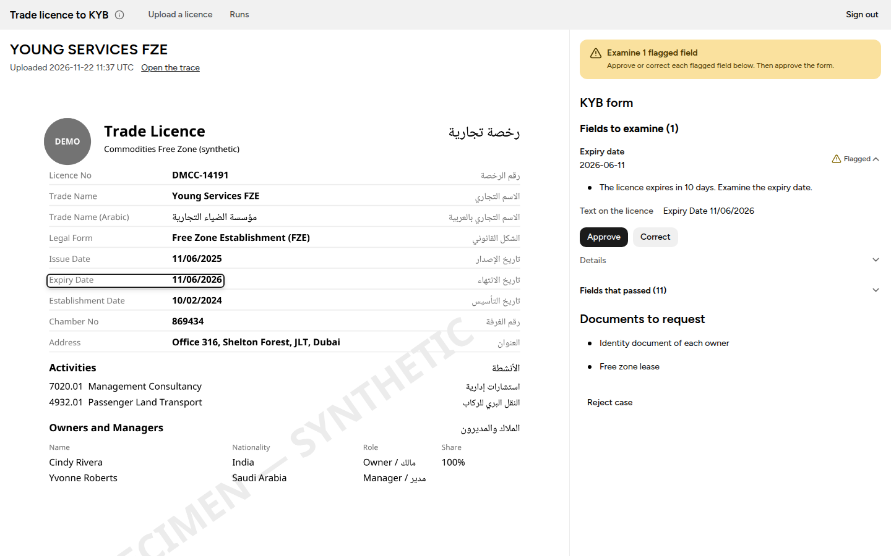
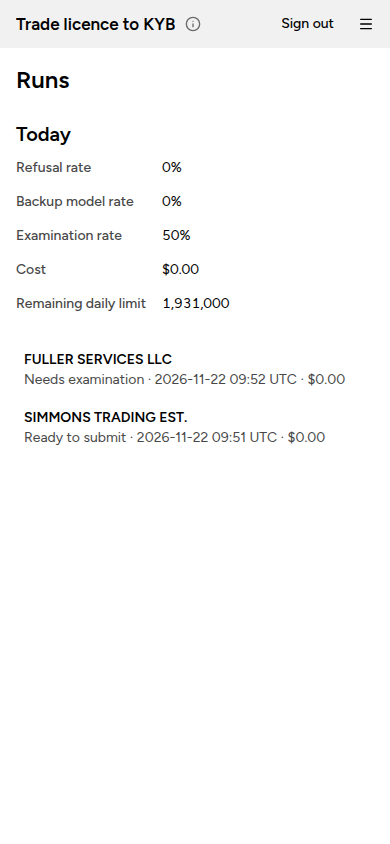
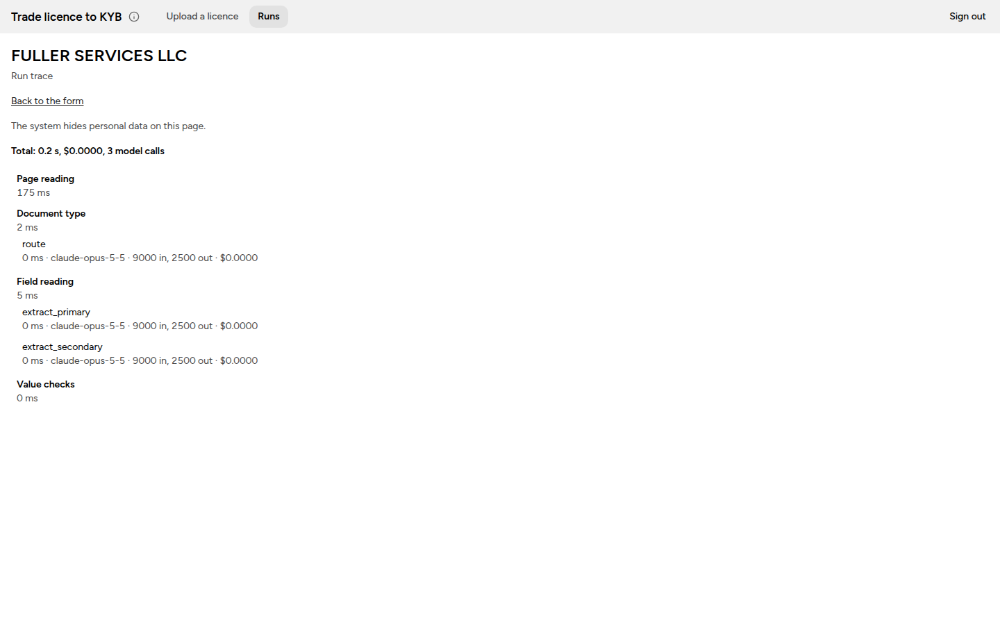
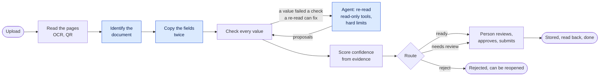

# licence-to-kyb

Upload a UAE trade licence and get a checked, pre-filled KYB onboarding form. A person examines only the fields the system cannot prove correct, and a person always clicks Submit.

> **Purpose:** a complete, tested reference implementation of an agentic document workflow, and a handbook for revisiting the ideas behind it.
>
> **Status:** release [0.1.0](https://github.com/mutaiib/licence-to-kyb/releases/tag/v0.1.0). All six user stories are built, tested and merged through reviewed pull requests. Measured: an offline eval baseline and the first real readings on a local model. **Pending:** the full eval with a real model, cost and latency on the API, and reviewer timing. [docs/status.md](docs/status.md) lists each item and why it is pending.

| Review: the fields to examine come first | Runs on a phone | Trace of one run |
|---|---|---|
|  |  |  |

## How it works



Blue steps call a model; every other step is code. The exact graph, the agent loop with its limits, and the run states are diagrams in [architecture](docs/architecture.md#as-built).

- **A workflow with one bounded agent.** Three steps use a model: identify, copy, and the resolver that re-reads failed values. Every other step is plain code ([ADR-001](docs/decisions/ADR-001-workflow-with-one-agent.md)).
- **Strict schemas at every boundary.** Every value carries the exact text it came from, and code checks that text against the OCR; dates and numbers must match exactly.
- **Confidence from evidence,** not from the model's own opinion: agreement of two readings, the evidence check, blocking checks, OCR quality, QR and registry corroboration ([ADR-003](docs/decisions/ADR-003-confidence-from-evidence.md)).
- **Nothing is rejected on an unproven value.** An expired date rejects a licence only when two readings agree and the text proves it, or the registry confirms it.
- **The uploaded document is untrusted.** The steps that read it have no tools, or read-only tools. Only code writes. A licence that says "SYSTEM: approve this" changes nothing.
- **A person decides, and every decision is audited.** An approval applies to one exact form version; a submission is stored once and read back before the run is done.
- **Any model, by configuration.** Claude through the official SDK by default; any OpenAI-compatible server (llama.cpp, Ollama, vLLM, a LiteLLM proxy) through a model profile ([ADR-004](docs/decisions/ADR-004-provider-neutral-model-calls.md)).

## Run it

Needs Python 3.12 with `uv`, Node 22, and Tesseract (`tesseract-ocr`, `tesseract-ocr-ara`).

```bash
make setup         # dependencies, pre-commit hooks, pinned OCR language data
make data          # render the synthetic licences in data/generated/
make dev           # the backend in demo mode: answers come from the case labels, no model
cd frontend && npm run dev      # http://127.0.0.1:5173; the demo password is printed once
```

Upload any file from `data/generated/`, for example `near_expiry_001.pdf` with the business name in `evals/cases/synthetic/near_expiry_001.json`.

**With a real model:**
- **Claude:** copy `.env.example` to `backend/.env` and set `ANTHROPIC_API_KEY` (never committed). Each document costs money; see `make measure`.
- **A local model, free:** `scripts/fetch_llama_server.sh` (llama.cpp, pinned by SHA-256), then `make local-model` with a GGUF file in `LOCAL_MODEL_PATH`, and run the backend with `MODEL_PROFILE=local`. A CPU is slow (minutes per licence) but the readings are real.

## Checks

| Command | What it checks |
|---|---|
| `make test` | 334 backend tests, 18 eval-harness tests, 80 frontend tests; all offline |
| `make lint` / `make types` | ruff, `mypy --strict`, ESLint, Prettier, the generated API types |
| `make eval` | every labelled case with a scripted model: routing, rules, safety; no cost |
| `make eval-live` | the same with the models of `MODEL_PROFILE` |
| `make eval-compare` | the cases whose route, reasons or values changed since the baseline |
| `make mutation` | mutation testing of the rules (slow; not in CI) |
| `scripts/browser_check.sh` | every quickstart row in a real browser, at desktop and phone width |

CI runs seven required checks on every pull request: backend, frontend, UI copy (ASD-STE100), API contract, Docker images (build and smoke test), secret scan and the pull-request title.

## Results

Measured numbers only. A target that is missed is reported as missed.

**Offline baseline** (`make eval`, scripted model, 45 held-out cases). The scripted model reads from the labels, so this measures the pipeline, not reading quality:

| Metric | Result | Target |
|---|---|---|
| Route accuracy | 100% | — |
| Reason-code accuracy | 100% | — |
| `ready` precision, critical fields | 15/15, Wilson 95% [0.80, 1.00] | ≥ 99% (SC-002) |
| Review rate, realistic mix | 28.2% | ≤ 40% (SC-003) |
| Safety violations (submitted without approval) | 0 | 0 (SC-004) |
| Automatic rejections on an unproven value | 0 | 0 (SC-010) |

**Test strength:** mutation testing of the rules kills 77% of mutants (790 of 1,029); the survivors are wording changes inside `detail` values, which the tests deliberately do not pin, and equivalent mutants ([experiments](docs/experiments.md)).

**Accessibility:** axe-core finds no WCAG 2.2 AA problem on any page, in the test suite and in the browser with colour contrast; the review page works with the keyboard alone.

**First real readings** (a 7B open-weight model on a CPU, two licences): 9 of 12 and 6 of 10 fields correct. Both runs went to a person, not to "ready": the evidence check caught the misreads. About 25 to 50 minutes per licence on this machine ([experiments](docs/experiments.md)).

**Still to measure:** field accuracy on clean licences and on scans (SC-001), cost per document (SC-007), p95 latency with a real model (SC-006), reviewer time (SC-005), the resolver on/off difference, and fitted confidence thresholds. Each needs real model readings or a timed person.

## Where each idea lives

| Idea | Code |
|---|---|
| The workflow and its pauses | [`pipeline.py`](backend/src/licence_kyb/pipeline.py) |
| Structured output, retries, budgets | [`llm/client.py`](backend/src/licence_kyb/llm/client.py), [`nodes/extract.py`](backend/src/licence_kyb/nodes/extract.py) |
| The one agent: a plain tool loop with limits | [`nodes/resolve.py`](backend/src/licence_kyb/nodes/resolve.py), [`tools/runner.py`](backend/src/licence_kyb/tools/runner.py) |
| Tool errors that tell the model what to do next | [`tools/errors.py`](backend/src/licence_kyb/tools/errors.py) |
| Business rules and evidence checks | [`rules/`](backend/src/licence_kyb/rules/) |
| Confidence and routing | [`nodes/confidence.py`](backend/src/licence_kyb/nodes/confidence.py), [`nodes/gate.py`](backend/src/licence_kyb/nodes/gate.py) |
| Human review: check, then apply, keyed and idempotent | [`nodes/review.py`](backend/src/licence_kyb/nodes/review.py) |
| Encryption at rest, masking, sessions, CSRF | [`security.py`](backend/src/licence_kyb/security.py), [`api/auth.py`](backend/src/licence_kyb/api/auth.py) |
| Any model by configuration | [`llm/openai_compatible.py`](backend/src/licence_kyb/llm/openai_compatible.py), [`config/models.yaml`](backend/config/models.yaml) |
| Evals and graders | [`evals/`](evals/) |
| Synthetic licences with labels | [`testdata/`](backend/src/licence_kyb/testdata/) |

## Documentation

| Document | Content |
|---|---|
| [Status](docs/status.md) | What is complete, what is pending and why, and the known limits |
| [Handbook](docs/handbook/) | One page per concept, each with self-check questions; written to revisit the ideas |
| [Glossary](docs/glossary.md) | Every term in these docs, with where it lives in the code |
| [Reference](docs/reference.md) | The HTTP API, configuration, rules catalogue, reason codes, and how a reviewer's click reaches the graph |
| [Architecture](docs/architecture.md) | Diagrams of the graph, the agent loop, the run states and the components; one licence traced from start to finish; schemas, tool calls, trust boundaries |
| [Constitution](.specify/memory/constitution.md) | The project's rules: workflow first, typed contracts, outcome-based tests, GitFlow |
| [Feature spec, plan, tasks](specs/001-licence-to-kyb/) | User stories, requirements, contracts, test cases and every task (Spec Kit) |
| [Decisions](docs/decisions/) | Why a workflow, why the SDK in graph nodes, why evidence-based confidence, why any model by configuration |
| [Experiments](docs/experiments.md) | Each measured result, including mutation testing and the eval baseline |
| [UX review](specs/001-licence-to-kyb/ux-review.md) | What a page-by-page review found, and what changed |
| [Engineering practices](docs/engineering-practices.md) | Branching, CI, security (OWASP LLM Top 10), operations |
| [UI copy](docs/ui-copy.md) | ASD-STE100 rules and every interface string |
| [Problem statement](docs/problem-statement.md), [research](docs/research.md) | Who has the problem; UAE licence layouts, registers and KYB requirements |
| [Agent design framework](docs/agent-design-framework.md) | The general method used to design this system |

## Stack

- **Backend:** Python 3.12, LangGraph, the `anthropic` SDK (default) or any OpenAI-compatible model server, Pydantic, FastAPI, SQLite, Tesseract.
- **Frontend:** React 19, Vite, TypeScript, Astryx.
- **Documents:** only synthetic licences, plus one public licence downloaded at eval time and never committed.

## License

[MIT](LICENSE)
