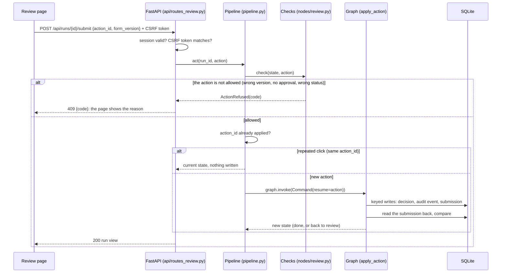

# Reference

Lookup tables for the API, the configuration, the rules and the reason codes, and one diagram
of how a reviewer's click reaches the graph. Paths are relative to `backend/src/licence_kyb/`
unless they start with a top-level folder. The full HTTP contract is
[contracts/http-api.md](../specs/001-licence-to-kyb/contracts/http-api.md).

## How a reviewer action reaches the graph

Every action (review, submit, reopen, retry) takes the same path. The check runs first and
has no side effects; only the graph writes, and every write is keyed by the action's ID.

## HTTP API

All routes except the health checks need a signed-in session; every `POST` and `DELETE`
also needs the CSRF token.

| Method and path | What it does | File |
|---|---|---|
| `GET /healthz`, `GET /readyz` | Liveness; readiness of the database and checkpoints | `api/routes_health.py` |
| `POST /api/session`, `DELETE /api/session` | Sign in (argon2id, rate limited), sign out | `api/routes_session.py` |
| `POST /api/runs` | Upload a licence with the applicant's business name; starts a run | `api/routes_runs.py` |
| `GET /api/runs` | List runs | `api/routes_runs.py` |
| `GET /api/runs/{id}` | One run: status, route, reasons, form, steps | `api/routes_runs.py` |
| `GET /api/runs/{id}/pages/{n}` | One page image (decrypted on the fly) | `api/routes_runs.py` |
| `POST /api/runs/{id}/review` | Field decisions; approve or reject the form | `api/routes_review.py` |
| `POST /api/runs/{id}/submit` | Submit the approved form version; read it back | `api/routes_review.py` |
| `POST /api/runs/{id}/reopen` | Reopen a rejected case, with a reason | `api/routes_review.py` |
| `POST /api/runs/{id}/retry` | Retry processing after a processing failure | `api/routes_review.py` |
| `GET /api/runs/{id}/trace` | Every step, model call and tool call, PII masked | `api/routes_trace.py` |
| `GET /api/metrics/summary` | Today's runs, review rate, refusals, cost, budget left | `api/routes_trace.py` |

## Configuration

**Environment** (copy `.env.example` to `backend/.env`; never commit it):

| Variable | Meaning |
|---|---|
| `ANTHROPIC_API_KEY` | Key for the `anthropic` profile |
| `MODEL_PROFILE` | `anthropic` (default) or `local`; see `backend/config/models.yaml` |
| `MODEL_API_KEY` | Key for an OpenAI-compatible server, if it needs one |
| `FERNET_KEYS` | Encryption keys for files and stored data; the first one encrypts, all of them decrypt (rotation) |
| `SESSION_SECRET` | Signs the session cookie |
| `REVIEWER_ACCOUNTS` | Reviewer names with argon2id password hashes |
| `DAILY_TOKEN_BUDGET` | Tokens per day; when used up, new runs go straight to review |
| `RETENTION_DAYS` | How long runs and their files are kept |
| `APPLICANT_NAME_THRESHOLD` | Similarity below which the applicant's name is flagged |
| `DATA_DIR` | Where the databases and encrypted files live |
| `COOKIE_SECURE` | Send the cookie over HTTPS only (true in production) |
| `TESSDATA_PREFIX` | Where Tesseract finds its pinned language data |

**Files** in `backend/config/`:

| File | Holds |
|---|---|
| `models.yaml` | One profile per provider: the model, effort and `max_tokens` of each step; `vision`; prices; `deadline_seconds` and `resolver_seconds` for a slow model |
| `budgets.yaml` | The resolver limits: turns, tokens, tool calls, seconds (soft and hard), rounds |
| `thresholds.yaml` | The confidence threshold of each field; `fitted: false` until calibrated on real readings |

## Rules

Each rule is plain code in `rules/` and returns one result per field it checks. A `block`
result keeps the run from `ready`; a `warn` result flags the field. "Re-readable" means the
resolver may try to fix it ([`nodes/resolve.py`](../backend/src/licence_kyb/nodes/resolve.py)).

| Rule | Fields | Severity | Reason code when it fails | Re-readable |
|---|---|---|---|---|
| `expiry` | expiry date | block / warn | `expired` (block), `near_expiry` (warn, fewer than 30 days) | — |
| `date_order` | issue and expiry dates | block | `date_order` | yes |
| `number_format` | licence number | block | `number_format` | yes |
| `evidence` | every read field | warn | `evidence_mismatch` | yes |
| `qr` | licence number | block | `qr_mismatch` | yes |
| `registry` | licence number, expiry date | block | `registry_not_found`, `registry_expiry_mismatch`, or `registry_unavailable` (could not run; a reviewer can override it) | `registry_not_found` |
| `legal_form` | legal form | block | `legal_form_not_allowed` | — |
| `shares_total` | people | block | `shares_total` | — |
| `sole_owner_count` | legal form, people | block | `sole_owner_count` | — |
| `ubo` | people | warn | `ubo_needs_examination` | — |
| `owners` | people | warn | `owners_unclear` | — |
| `arabic_name` | Arabic trade name | warn | `arabic_name_missing` | — |
| `high_risk_activity` | activities | warn | `high_risk_activity` | — |
| `applicant_name` | English trade name | warn | `applicant_name_mismatch` | — |
| `required` | every required field | warn | `low_confidence` | — |

**After the rules:** an `expired` result that neither two agreeing readings nor the registry
corroborates becomes `expiry_uncertain` (re-readable). The confidence step adds
`low_confidence` to a field below its threshold that has no other failed check.

## Reason codes

The UI shows each code as one sentence (`frontend/src/copy.ts`, `reason.*`). Codes are
defined in [`schemas/results.py`](../backend/src/licence_kyb/schemas/results.py).

| Group | Codes | Effect on the route |
|---|---|---|
| File | `invalid_type`, `too_large`, `too_many_pages`, `image_too_large`, `unreadable_file` | The upload is refused or the run is rejected |
| Document | `out_of_scope`, `unclear_document`, `unknown_authority` | `out_of_scope` rejects; the others need review |
| Expiry | `expired`, `expiry_uncertain`, `near_expiry` | A corroborated `expired` rejects; the others need review |
| Values | `number_format`, `date_order`, `shares_total`, `sole_owner_count`, `legal_form_not_allowed`, `arabic_name_missing`, `high_risk_activity`, `evidence_mismatch`, `qr_mismatch`, `registry_not_found`, `registry_expiry_mismatch`, `registry_unavailable`, `applicant_name_mismatch`, `owners_unclear`, `ubo_needs_examination`, `low_confidence` | Need review |
| Process | `processing_failed`, `budget_exhausted`, `fallback_model`, `resolver_budget`, `verification_failed`, `reviewer_rejected` | Need review (a reviewer can retry `processing_failed` and `budget_exhausted`); `reviewer_rejected` marks a rejection by a person |
| Escape | `other` | Needs review |
