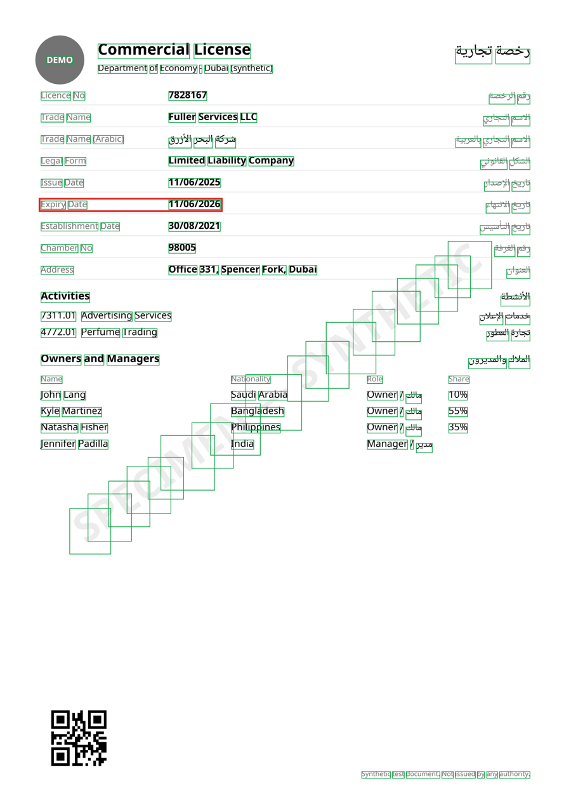
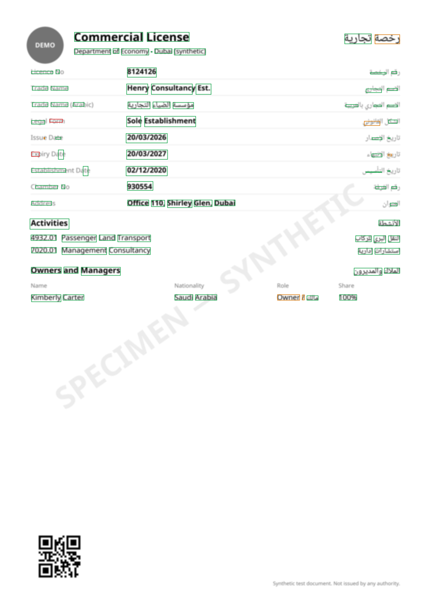
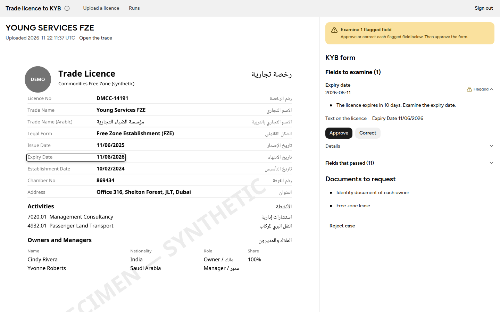

# Walkthrough: one licence, start to finish

This page follows one synthetic licence through the real system. `make walkthrough`
([`scripts/walkthrough.py`](../scripts/walkthrough.py)) writes it from an actual run, so
every number, text and image below is the code's own output.

> **What is real and what is scripted.** Every step runs the real code: intake, page
> reading, the rules, the resolver's tools, confidence, the gate, the form, the review
> actions, submit and read-back. Only the **model calls are scripted** (the `demo` profile,
> model `demo-labels`): they answer from the licence's labels, so the page is the same on
> every machine and costs nothing. To show how the system deals with a misreading, the
> scripted model **reads the expiry year wrong** in its first reading.

**The licence:** `data/generated/near_expiry_001.pdf`, a synthetic DET licence that expires 10 days after
"today" (the clock is fixed at 2026-06-01 for tests and demos).


## 1. Intake: check the file before any work

Plain code, no model ([`nodes/intake.py`](../backend/src/licence_kyb/nodes/intake.py)).

| Check | Result |
|---|---|
| File type, from its first bytes (not its name) | `application/pdf` |
| Size (limit 10 MB) | 48,696 bytes |
| Pages (limit 5) | 1 |
| Seen before? (SHA-256 of the bytes) | no: a new run, `2a573288…` |
| Stored | encrypted (Fernet); nothing is kept in plain text |

## 2. Read the pages, in a separate, limited process

The upload is untrusted: a small PDF can inflate to gigabytes. A child process reads it,
with a memory and time limit (1 GB, 60 s); a file past either is rejected
([`nodes/isolate.py`](../backend/src/licence_kyb/nodes/isolate.py),
[`nodes/preprocess.py`](../backend/src/licence_kyb/nodes/preprocess.py)).

1. **Render** each page to an image at 200 DPI (1654 by 2339 pixels). The model sees
   these images, the QR decoder scans them, and the review page shows them.
2. **Get the words.** This PDF has a **text layer**, so its words come from it directly:
   exact text, confidence 1.0. Source: `text_layer`, **141 words**. (A scan has no
   text layer; then Tesseract reads the image, in English and Arabic: see the box below.)
3. **Keep each word's box** on the page. A PDF lists words in drawing order, which can split
   a label from its value, so code regroups them into visual rows, read left to right.
4. **Decode the QR code**, as untrusted text that is never opened: `7828167`.

The words and their boxes. The red box is the evidence for the expiry date (steps 5 and 6).
The single letters on the diagonal are the "SPECIMEN — SYNTHETIC" watermark: words too.



The text the model receives (the first 8 visual rows):

```text
Commercial License
DEMO ﺔﻳﺭﺎﺠﺗ ﺔﺼﺧﺭ
Department of Economy - Dubai (synthetic)
Licence No 7828167 ﺔﺼﺧﺮﻟﺍ ﻢﻗﺭ
Trade Name Fuller Services LLC ﻱﺭﺎﺠﺘﻟﺍ ﻢﺳﻻﺍ
Trade Name (Arabic) ﻕﺭﺯﻷﺍ ﺮﺤﺒﻟﺍ ﺔﻛﺮﺷ ﺔﻴﺑﺮﻌﻟﺎﺑ ﻱﺭﺎﺠﺘﻟﺍ ﻢﺳﻻﺍ
Legal Form Limited Liability Company ﻲﻧﻮﻧﺎﻘﻟﺍ ﻞﻜﺸﻟﺍ
Issue Date 11/06/2025 ﺭﺍﺪﺻﻹﺍ ﺦﻳﺭﺎﺗ
```

**The Arabic looks backwards, and that is expected.** This PDF stores Arabic in visual order
(drawn left to right) with "presentation form" letters. The evidence check normalises the
letters (Unicode NFKC) and compares each quote with the text both ways
([`rules/grounding.py`](../backend/src/licence_kyb/rules/grounding.py)).

One word, as stored. The box is (left, top, right, bottom), as fractions of the page:

```json
{
  "page": 1,
  "text": "7828167",
  "bbox": [
    0.2952,
    0.1128,
    0.3625,
    0.1247
  ],
  "conf": 1.0
}
```

> **A scan instead of a PDF.** `scans_001.jpg` is a photographed copy with no text layer,
> so Tesseract reads it: **91 words**, mean confidence **0.93**,
> **2** below 0.6. Green: at least 0.9; orange: 0.6 to 0.9; red: below 0.6.
> The bold values read well; the faint grey labels and much of the Arabic do not. That is
> why each field's confidence includes the OCR confidence of the words its quote came from.
>
> 

## 3. Route: what document is this? (model, no tools)

The model gets page 1 and the first 1,500 characters of the text. Its prompt says that the
document's text is data, never instructions. Its answer (scripted here):

```json
{
  "doc_type": "trade_licence",
  "authority": "DET",
  "has_arabic": "true"
}
```

Code then checks the answer against the page: the licence number in the text has the
DET number format, so the authority stands. Result: `trade_licence`, `DET`.

## 4. Extract: read the fields, then the key fields again (model, no tools)

**The first reading** fills the whole schema. Each value carries the exact text it was read
from (`evidence_quote`). Here it **misreads the expiry year**:

```json
{
  "licence_number": {
    "value": "7828167",
    "status": "present",
    "evidence_quote": "Licence No 7828167",
    "page": 1
  },
  "expiry_date": {
    "value": "2028-06-11",
    "status": "present",
    "evidence_quote": "Expiry Date 11/06/2028",
    "page": 1
  }
}
```

**The second reading** is a separate call that reads only the critical fields. It reads the
expiry date right:

```json
{
  "expiry_date": {
    "value": "2026-06-11",
    "status": "present",
    "evidence_quote": "Expiry Date 11/06/2026",
    "page": 1
  }
}
```

The two readings **disagree** on the expiry date, so their agreement is no evidence for it.

## 5. Validate: run every rule (code)

32 rule results. The ones that failed:

| Rule | Field | Severity | Reason |
|---|---|---|---|
| `evidence` | expiry_date | warn | `evidence_mismatch` |
| `registry` | licence_number, expiry_date | block | `registry_expiry_mismatch` |

- `evidence`: the value says 2028-06-11, but its own quote says `Expiry Date 11/06/2026`.
  Dates must match the text exactly.
- `registry`: the (mock) register holds a different expiry date.

A re-read can fix both, so the resolver runs.

## 6. Resolve: the one agent (model with read-only tools)

The resolver gets the failed fields and 7 tools (`licence_reread_region`, `licence_ocr_region`, `licence_lookup_registry`, `licence_lookup_activity`, `licence_get_validation_report`, `propose_fix`, `finish`). The `field` argument
lists only the fields that failed. Its turns (the decisions are scripted; **the tools are
real**):

1. It calls `licence_ocr_region` on the `top_left` region of page 1, where the expiry date
   is printed. **The real tool runs.** Its answer, in words (an excerpt):

   ```text
   … 0), 'Form' (1.00), 'Limited' (1.00), 'Liability' (1.00), 'Company' (1.00), 'Issue' (1.00), 'Date' (1.00), '11/06/2025' (1.00), 'Expiry' (1.00), 'Date' (1.00), '11/06/2026' (1.00), 'Establishment' (1.00), 'Date' (1.00), '30/08/2021' (1.00), 'Chamber' (1.00), 'No' (1.00), '98005' (1.00), 'Address' (1.00), 'Office' (1.00), '331,' ( …
   ```

2. It proposes a fix, with the quote it read, and finishes:

```json
{
  "field": "expiry_date",
  "new_value": "2026-06-11",
  "evidence_quote": "Expiry Date 11/06/2026",
  "self_confidence": "high",
  "rationale": "The OCR text of the top_left region shows a different year."
}
```

**The agent never applies a value.** Code runs every rule on the proposal: the evidence and
the registry now agree, so the fix is accepted (`True`). Neither reading saw the new
value, so their agreement for this field is reset.

## 7. Validate again, then score confidence (code)

The evidence and registry checks now pass. One rule still fails, by design:

| Rule | Field | Severity | Reason |
|---|---|---|---|
| `expiry` | expiry_date | warn | `near_expiry` |

**Confidence** combines six signals, weighted: agreement 3, grounding 3, rules 2,
corroboration 2, OCR 1, the model's own rating 0.5.

| Field | agreement | grounding | rules | ocr | corroboration | self_rating | **Score** | Threshold |
|---|---|---|---|---|---|---|---|---|
| `licence_number` | 1.00 | 1.00 | 1.00 | 1.00 | 1.00 | 1.00 | **1.00** | 0.9 |
| `trade_name_en` | 1.00 | 1.00 | 1.00 | 1.00 | — | 1.00 | **1.00** | 0.85 |
| `legal_form` | 1.00 | 1.00 | 1.00 | 1.00 | — | 1.00 | **1.00** | 0.85 |
| `expiry_date` | 0.00 | 1.00 | 1.00 | 1.00 | 1.00 | 1.00 | **0.74** | 0.9 |

"—" means there is no evidence of that kind for the field (for example, the register holds
no trade name). It does not count, so it does not lower the score. The expiry date scores
0.74, below its threshold: the two readings no longer agree on it, so it goes
to a person even after the fix.

## 8. Gate: pick the route (code)

Route: **`needs_review`**. Reasons: `near_expiry`. A licence that expires in 10 days needs a
person's decision; a licence whose expiry is confirmed in the past would be rejected.

## 9. The KYB form, and the documents to request (code)

11 fields passed; one needs a decision: `expiry_date`.
Documents to request: identity document, memorandum of association, tenancy contract ejari.

The run now **pauses** (LangGraph `interrupt`): its state is saved, and it survives a restart.

## 10. A person decides (the review page)



The reviewer approves the flagged field, approves the form (the approval holds for this exact
form version only), and submits. Each click is checked first, and every write is keyed, so a
repeated click writes nothing new.

## 11. Submit, read back, done (code)

The form is stored once, **read back and compared** with the approved form, and only then is
the run done. Final status: **`done`**. Submission verified: `True`.

The audit trail (values and reasons are stored encrypted):

| # | Action | By | Meaning |
|---|---|---|---|
| 1 | status_change | system | processing ended; the run waits for a person |
| 2 | approve | reviewer1 | the reviewer approved one flagged field |
| 3 | approve_form | reviewer1 | the reviewer approved this form version |
| 4 | submit | reviewer1 | the form was stored once |
| 5 | verify | system | the stored record was read back and matched |

## What to take away

- **The model reads; code decides.** Three steps call a model; every check, score, route and
  write is plain code.
- **The text on the page is evidence, not only input.** Every value must quote it exactly,
  and that is what caught the misread year.
- **The agent proposes; the rules accept.** The resolver used a real, read-only tool and could
  not apply its own fix.
- **A person still decides what matters.** A fixed value that the two readings did not agree
  on, and a licence close to expiry, both go to a reviewer.

See also: [architecture](architecture.md) (the diagrams), [glossary](glossary.md),
[reference](reference.md) (rules and reason codes), [status](status.md).
